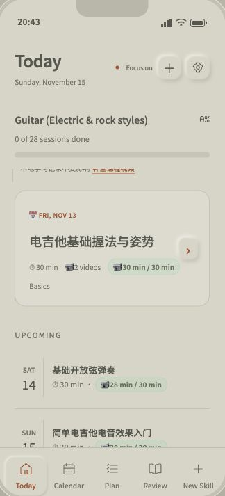

# tva-retro-ui
TVA 复古仪器 UI 的 Codex Skill，包含 Figma 组件索引、材质规范和交互参考。

## 安装 Skill

在已安装 Codex 的电脑上，打开终端运行下面的命令，让这个 Skill 在你的所有项目里可用。

```bash
mkdir -p "$HOME/.agents/skills"
git clone --depth 1 https://github.com/bbds2802-maker/tva-retro-ui.git "$HOME/.agents/skills/tva-retro-ui"
```

- 只在一个项目使用时，在该项目根目录运行上述命令，并把两处 `$HOME/.agents/skills` 换成 `.agents/skills`。
- 也可以在本仓库的 **Code → Download ZIP** 下载。解压后把文件夹改名为 `tva-retro-ui`，放进 `~/.agents/skills/`。安装后，`SKILL.md` 应直接位于 `tva-retro-ui/` 下，旁边是 `agents/` 和 `references/`。
- 如果 Codex 列表里没有出现 `tva-retro-ui`，重启 Codex，再检查目录层级。[OpenAI 官方文档](https://learn.chatgpt.com/docs/build-skills#where-codex-loads-local-skills)

## 使用 Skill

在 Codex 输入 `$tva-retro-ui`，选中技能，再说明要做的界面和交付方式。

> 用 $tva-retro-ui 做一个青绿主题的信号校准网页。用 CRT 显示波形，让旋钮和滑杆能调节数值，交付可运行的 HTML、CSS 和 JavaScript。

> 用 $tva-retro-ui 在 Figma 里做一块橙色仪器面板，复用原组件，给我可操作的原型。

在 Figma 里直接复用原组件需要相应的文件权限和可用的 Figma 连接。[查看 Figma 组件索引](references/figma-library.md)

## 网页示例

[TVA 信号接收台](demo/) 是可交互的静态网页，包含频道切换、频率微调、增益、扫描、波形冻结和双配色。下载仓库后，用浏览器打开 `demo/index.html` 即可运行。

## 成果预览

| TVA 时序监视器 | 暖灰 ABS 界面图标 | 移动端学习界面 |
| --- | --- | --- |
|  |  |  |
