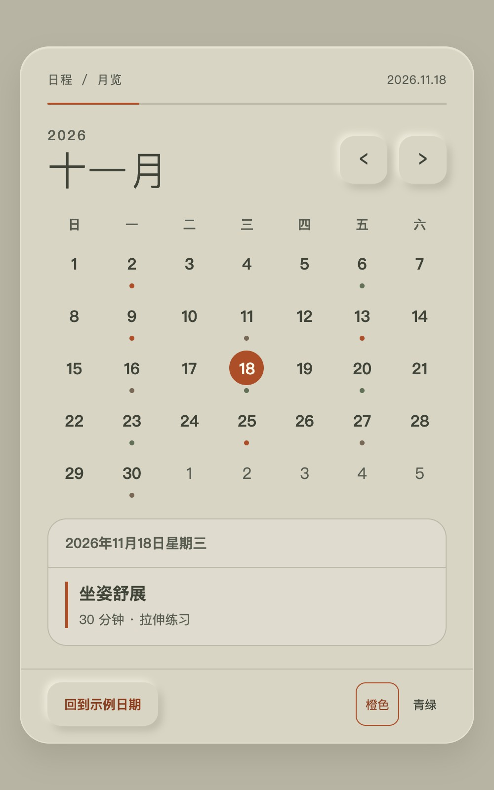
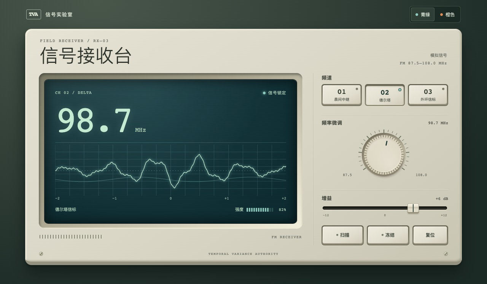
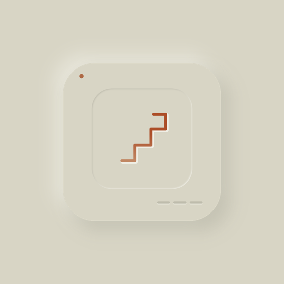

# tva-retro-ui

一套 TVA 风格的 Codex Skill，包含复古实体仪器和柔和拟物触屏两种方向，以及 Figma 组件索引、材质规范和可交互示例。

## 安装 Skill

在已安装 Codex 的电脑上，打开终端运行下面的命令，让这个 Skill 在你的所有项目里可用。

```bash
mkdir -p "$HOME/.agents/skills"
git clone --depth 1 https://github.com/bbds2802-maker/tva-retro-ui.git "$HOME/.agents/skills/tva-retro-ui"
```

- 只在一个项目使用时，在该项目根目录运行上述命令，并把两处 `$HOME/.agents/skills` 换成 `.agents/skills`。
- 也可以在本仓库的 **Code → Download ZIP** 下载。解压后把文件夹改名为 `tva-retro-ui`，放进 `~/.agents/skills/`。保留同级的 `SKILL.md`、`agents/`、`references/` 和 `assets/`。
- 如果之前用上述命令安装过，可以运行 `git -C "$HOME/.agents/skills/tva-retro-ui" pull --ff-only` 更新。通过 ZIP 安装的用户可重新下载。
- 如果 Codex 列表里没有出现 `tva-retro-ui`，重启 Codex，再检查目录层级。[OpenAI 官方文档](https://learn.chatgpt.com/docs/build-skills#where-codex-loads-local-skills)

## 使用 Skill

在 Codex 输入 `$tva-retro-ui`，选中 Skill，再说明使用场景、配色和交付方式。

- **复古实体仪器**：适合信号接收台、校准面板和控制台。使用暖灰 ABS 外壳、嵌入式 CRT、实体按键和有行程的旋钮及推子。[材质与控件规范](references/material-and-controls.md)
- **柔和拟物触屏**：适合日历、计划和阅读界面。内容贴在同色哑光底面，少数操作微微浮起；橙色或青绿用于选中状态。[触屏材质与层级](references/soft-touch.md)

> 用 $tva-retro-ui 做一个青绿主题的信号校准网页，用 CRT 显示波形，让旋钮和滑杆能调节数值。

> 用 $tva-retro-ui 的柔和拟物触屏风格做一个暖灰日历。翻月键微微浮起，日期保持平整，选中日期用氧化橙，并做成可操作的 HTML。

> 用 $tva-retro-ui 在 Figma 里做一块橙色仪器面板，复用原组件，给我可操作的原型。

在 Figma 里直接复用原组件需要相应的文件权限和可用的 Figma 连接。[查看 Figma 组件索引](references/figma-library.md)

## 网页示例

下载仓库后，在浏览器打开对应的 HTML 文件即可试玩，无需安装依赖。

- [柔和拟物日历](assets/soft-touch-calendar.html)：翻月、选择日期、查看示例日程，或切换橙色和青绿。
- [TVA 信号接收台](demo/index.html)：切换频道、微调频率、调节增益，或扫描和冻结波形。

## 成果预览

| 柔和拟物日历 | 复古实体仪器 |
| --- | --- |
|  |  |

早期设计探索：

| TVA 时序监视器 | 暖灰 ABS 界面图标 | 移动端学习界面 |
| --- | --- | --- |
|  |  |  |
